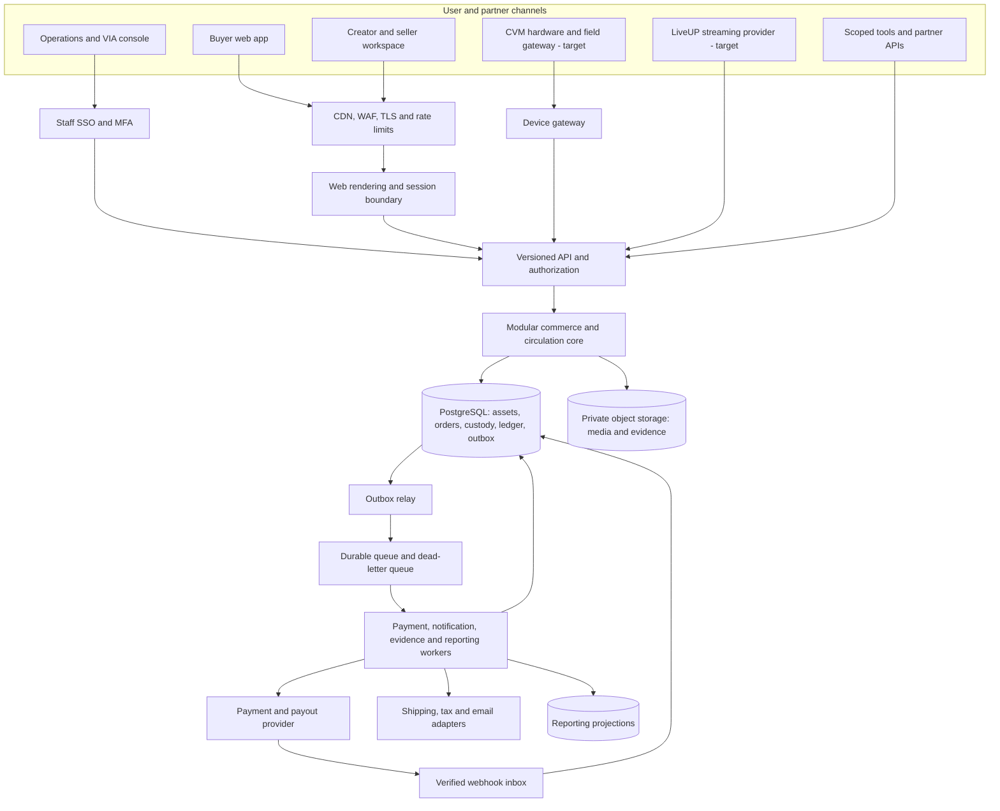
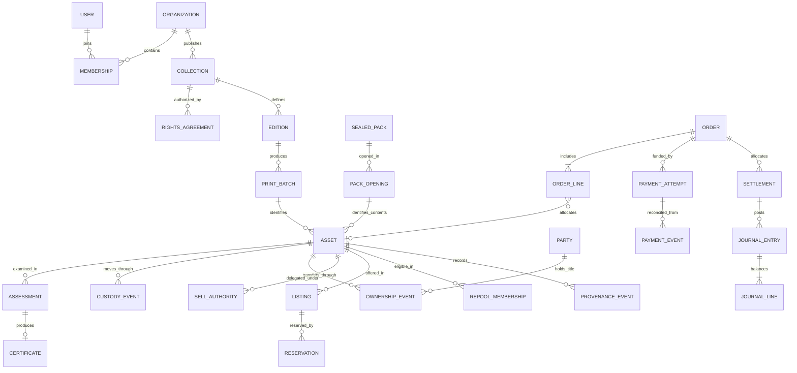
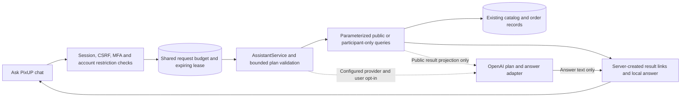

# PixUP system architecture plan

Updated October 30, 2026 after reviewing all 40 pages of [PixUP-BP-J.pdf](../../PixUP-BP-J.pdf) and all 18 pages of [PixUP-Pitch-J.pdf](../../PixUP-Pitch-J.pdf). References use physical PDF pages; BP appendices A1–A16 are pages 25–40. Read with the [business review and decision register](README.md), [backend plan](02-backend-development-plan.md), [frontend plan](03-ui-frontend-development-plan.md) and [implementation status](../implementation-status.md). Scope remains web marketplace and invited creators first, followed by CVM and LiveUP pilots, as selected by the user.

Implementation baseline reconciled October 30, 2026 through migrations **001–016**, Community Hub, display-only Operations/community/channel previews, and **Ask PixUP / PixUP Guide**. The current-pilot gap review implements shared assistant quotas, dedicated assistant route recovery, unknown-route HTTP 404s and preview isolation coverage. See the [implementation gap review](05-current-pilot-gap-review.md) for source references, verification and the remaining roadmap. Existing identity, evidence, commerce, SaaS, trust, channel and commercial-policy controls remain in place. Hosted-provider acceptance, actual hardware/carrier operation, production commercial approval and live-money readiness remain outstanding.

## 0. Implemented baseline and PDF-driven changes

Community Hub extension (migration 015): the [Community Hub plan](04-community-hub-development-plan.md) now has a gated member-only text implementation covering topics, posts, stories, comments, profiles, interests, notifications and scoped moderation/appeals. It reuses identity and safe catalog projections while remaining separate from commerce and provenance. See the [pilot runbook](../community-hub.md) for role/MFA setup, privacy behavior, verification and remaining rollout/media work; both rollout flags default off.

Item 1 local increment (migration 014): a versioned seven-topic commercial register now separates documentary local reviews from executable pilot controls. Independent current finance reviewers can pause/restore PixUP-owned credit redemption or new checkout. Shared transaction-core locking and immutable quote/order snapshots prevent approval races and retroactive terms changes. Demo economics and the 18+ baseline remain; production contracts, taxation and jurisdiction approvals are unresolved. See [implementation and boundaries](../commercial-policy.md).

This is an incremental target architecture. The existing source already implements a local lifecycle pilot; the deployment diagram below describes the production target, not provisioned infrastructure.

| Boundary               | Implemented local/test behavior                                                                                                                                      | Required evolution                                                                                                                          |
| ---------------------- | -------------------------------------------------------------------------------------------------------------------------------------------------------------------- | ------------------------------------------------------------------------------------------------------------------------------------------- |
| Application            | Next.js role workspaces; modular Express API; PGlite/PostgreSQL; migrations 001–016                                                                                  | Route/domain extraction, protected staff deployment, managed infrastructure and durable independent workers                                 |
| Identity               | Configurable OIDC/email, verified invitation links, password recovery, MFA/recovery/replacement, consented owner transfer and independent staff access review        | Hosted provider acceptance, deployment MFA enforcement, provider deprovisioning, authenticated account linking and all-factor-loss recovery |
| Tenancy and visibility | Nonowner API/worker checks, transaction-local actor context, collection/invitation/owner-transfer, Community Hub and assistant-quota row policies; shared publication checks | Extend policies across remaining private domains; managed credential provisioning and review |
| Assets and trust       | Structured Sports/K-pop attributes, sealed packs/reveals, item passports, reviewed price snapshots, observational attribution and signing/checkpoint tooling         | Rights contracts, production proofs, market calibration, independently managed signing keys and retained checkpoints                        |
| Payments               | Account-bound Stripe test Checkout, full/partial refunds, refund replacement review, dispute holds, gross-cash reconciliation and opt-in connected-balance transfers | Hosted Checkout/Connect acceptance, dispute loss accounting, transfer reversals, bank payouts and fee/net/bank reconciliation               |
| Commercial policy      | Seven-topic decision register, independent finance review, pilot checkout/credit controls and immutable quote/order snapshots                                        | Actual creator, protection, refund-window, tax and jurisdiction decisions; local review never approves production launch                    |
| RePool                 | Versioned offers, new consent on revision, one credit grant/title transfer and return handling                                                                       | Consigned pool authority, approved concentration/governance policy and production liability treatment                                       |
| Evidence and logistics | Private S3-compatible adapter, ClamAV adapter, content review, capture/seals/bins, incident holds and simulated carrier tracking                                     | Deployed storage/scanner acceptance, evidence procedures, independent object restoration and real carrier integration                       |
| SaaS and channels      | Versioned test plans, subscriptions/usage, delegated inventory, CVM/LiveUP then GOUP/WaxUP adapters and scoped Query/Match/Route                                     | Hosted billing lifecycle, real device/stream/fulfillment partners, resource agreements and production channel acceptance                    |
| Community and assistant | Migration 015 member content/moderation, Ask PixUP local search/help and opt-in AI adapter; display-only previews | Staged community rollout, live AI acceptance, answer-quality/data review and deployment-wide cost monitoring |
| Operations             | 18+ pilot declarations, privacy controls, metrics/alerts, encrypted backup/restore/load harnesses and CI recovery/role checks                                        | Available dependency assessment, independent security review, managed off-host recovery, alert delivery and representative sustained load   |

Stripe orders cannot use simulated refund/payout actions; live keys are rejected. Stripe test API checks include session creation/retrieval/expiry and fixture full/partial refunds. Actual hosted Checkout completion and Connect onboarding/transfers remain acceptance work. Database verification covers migrations 001–016, immutable financial/commercial history, concurrent recovery, nonowner API/worker roles and pooled actor-context reset. The CI workflow now includes the separate PostgreSQL recovery/role suite; the updated workflow has not been remotely dispatched.

| Shared requirement IDs                   | PDF evidence                                      | Architecture consequence                                                                                                                                |
| ---------------------------------------- | ------------------------------------------------- | ------------------------------------------------------------------------------------------------------------------------------------------------------- |
| R01–R04: lifecycle, issuance, VIA, PinUP | BP pp. 2–4, 10, 12–13; Pitch pp. 2, 5–6           | Source registration, authentication, condition, ownership and custody are separate facts; a registered sealed pack does not certify its future contents |
| R05–R08, R11: circulation and value      | BP pp. 5, 11, 23, 37–39; Pitch pp. 10, 12         | Separate pool membership, credit units, price observations, attribution, payables, custody valuation and actual reserve money                           |
| R09–R10, R12: services and channels      | BP pp. 7–8, 13–15, 27–30; Pitch pp. 7, 9, 11      | Shared commerce with adapters; permissions distinct from plans; read-only AI first                                                                      |
| R13: own-issuance impartiality           | BP pp. 4, 40                                      | Own-issued concentration policy plus identical VIA/pruning rules and conflict review                                                                    |
| R14: partner resource economics          | BP pp. 15, 25, 29                                 | Separate device, stock, protocol, operations and site ownership/contracts; one sale can involve several partners                                        |
| R15: measurable economics                | BP pp. 12, 15, 17–19, 34, 37; Pitch pp. 4, 13, 15 | Versioned metric definitions, actual acquisition/operating costs, deduplicated channel reporting and scenario separation                                |
| R16: category and entity boundary        | BP pp. 35–36, 39                                  | Market/category activation gates; non-collectible expansion needs distinct legal/account/risk boundaries and a licensing decision                       |

The decks' “never exits” circulation language is interpreted as durable history, not perpetual pool membership: a sold, withdrawn or retired item leaves eligible pool value while its record persists (BP pp. 5, 37, 39; Pitch p. 10).

## 1. Architecture decision

Evolve the existing modular monolith: one transactional backend organized into separately owned business modules, with independently scalable background workers. The production target uses managed PostgreSQL as the transactional source of truth, object storage for evidence/media, and a durable queue for asynchronous work. Retain the responsive consumer/partner application and extract an independently protected operations console.

This design keeps inventory, ownership, orders, and accounting close enough for reliable transactions while preserving boundaries for later separation. The year-one goals do not justify operating dozens of microservices. Extract a service only when measured load, deployment independence, or access isolation warrants it; likely early candidates are media processing, device connectivity, video, and ML inference.

The documents' five business layers (BP p. 9) are capability groups, not five mandatory deployment services. VIA, PulseRate, RePool, and SaaS share asset identities and policy versions; channel applications invoke the same commands.

## 2. Technology baseline and build/buy boundary

| Layer          | Proposed choice                                                                               | Reason and boundary                                                                                                                                               |
| -------------- | --------------------------------------------------------------------------------------------- | ----------------------------------------------------------------------------------------------------------------------------------------------------------------- |
| Web            | React + TypeScript + Next.js App Router                                                       | Server-render discoverable catalog pages; interactive workspaces; one language across product teams                                                               |
| Backend        | Retain TypeScript + Express; REST/OpenAPI                                                     | Existing domain services and transactions remain; expand shared response contracts and generated clients. NestJS migration is optional, not a delivery dependency |
| Database       | Managed PostgreSQL; SQL migrations with a typed query layer                                   | Relational constraints and transactions suit unique assets, custody, and financial records                                                                        |
| Cache          | Optional managed Redis once measured need exists                                              | Rate limits and short-lived cache; never authoritative inventory or financial balance                                                                             |
| Queue          | Managed queue such as AWS SQS                                                                 | Retryable, durable workers with dead-letter handling                                                                                                              |
| Media/evidence | S3-compatible object storage and CDN                                                          | Private originals, public derivatives, retention-controlled evidence                                                                                              |
| Hosting        | AWS ECS/Fargate, load balancer, RDS, S3, SQS, CloudFront/WAF                                  | One proposed cloud baseline; infrastructure as code; no Kubernetes requirement                                                                                    |
| Identity       | Configurable OIDC/email adapters alongside local sessions; local MFA and recovery implemented | Providers default off until configured; retain organization permissions in PixUP and validate deployed identity assurance                                         |
| Payments       | Stripe test Checkout, partial refunds/dispute holds and opt-in Connect test transfers         | Hosted acceptance, live marketplace suitability, transfer reversal and bank payout/accounting remain separate gates                                               |
| Shipping/tax   | Provider adapters selected after operational validation                                       | Buy carrier connectivity and tax calculation; retain shipment and tax evidence                                                                                    |
| Live video     | Managed streaming service in phase 5                                                          | Own stream-to-order/asset association; avoid building video transport                                                                                             |
| AI | TypeScript AssistantService with local search/help and an optional server-side OpenAI Responses adapter | Keep model planning separate from authorized SQL and commerce; external calls require configuration and user opt-in; separate inference workers only if later workloads require them |
| Telemetry      | OpenTelemetry-compatible traces, logs, metrics and alerts                                     | Follow an order or custody event across webhooks, workers, and providers                                                                                          |

Retain pinned working dependencies and record upgrade ownership. Cloud and live-payment selection is provisional: confirm business-model acceptance, regional support, data terms, operational limits, and total cost before contracting. A Stripe test account is configured; this plan provisions no infrastructure or live integrations.

Next.js supports server/client component composition for this rendering split. [Next.js App Router documentation](https://nextjs.org/docs/app)

## 3. Business modules and ownership

| Module                     | Owns                                                                               | Does not own                                                 |
| -------------------------- | ---------------------------------------------------------------------------------- | ------------------------------------------------------------ |
| Identity and organizations | Users, organizations, memberships, roles, delegated API clients                    | Payment-provider identity decisions                          |
| Rights and issuance        | IP rights evidence, collections, editions, print batches, approvals, issuance type | Authentication of every later physical specimen              |
| Catalog and asset registry | Category schemas, products/variants, individual physical assets, serials           | Current price truth or financial balances                    |
| VIA                        | Intake assessments, condition grading, evidence, certificates, revocation          | Sales commissions or payout authorization                    |
| Custody and inventory      | Locations, receipts, transfers, bins, stock, inventory reservations                | Legal entitlement changes without an authorized transaction  |
| Marketplace / PinUP        | Listings, search projection, offers later                                          | Owning money or certifying authenticity                      |
| Commerce and fulfillment   | Quotes, orders, payment attempts, shipments, returns, disputes                     | Direct writes to the journal                                 |
| Ledger and settlement      | Balanced postings, payable schedules, fees, credit accounts, reconciliation        | Price prediction or discretionary VIA overrides              |
| RePool                     | Eligibility, accepted intake offers, membership, governance cases and exits        | Destroying customer-owned items without authority            |
| PulseRate                  | Comparable trades, methodology versions, valuation snapshots                       | Guaranteeing a sale price                                    |
| Attribution / IFCI         | Verified source attribution and observational scores                               | Creating payment rights absent an active agreement           |
| SaaS billing               | Plans, subscriptions, usage and entitlements                                       | Granting business permissions solely from a plan tier        |
| Channel operations         | Devices, sessions, stock assignments, maintenance, partner commissions             | Separate copies of inventory, ownership, or settlement rules |
| Community Hub | Explicit member profiles, topics, moderated posts/comments, interests, notifications and appeals | Commerce, certificates, provenance and automatic attribution payments |
| Ask PixUP / PixUP Guide | Bounded search plans, permission-scoped results, curated help and optional AI explanations | Public buyer directory, account mutations, order execution, independent inventory or financial truth |
| Support and governance     | Cases, approvals, policy changes, operational audit                                | Unlogged administrative balance edits                        |

Each module exposes application commands and queries; other modules do not casually update its tables. The monolith can coordinate a database transaction across modules where required. Background reports and search views are expendable projections that can be rebuilt.

## 4. Multi-tenancy and permissions

One person may buy, sell, and belong to several creator or merchant organizations. Avoid a single exclusive `user_type`. Model a personal account plus memberships granting roles in organizations. Separate organization administrators, publishers, inventory operators, finance readers, and payout approvers.

Maintain a global public catalog and asset identity space. Private drafts, contracts, customer data, organization inventory controls, and financial records are scoped to the owning organization or account. A cross-organization order has explicit buyer/seller/fulfillment access rules; users must not gain all tenant records merely by being an order participant.

Every command checks actor, organization membership, resource relationship, action, verification status, and current lifecycle state. The server derives organization access from authenticated membership, never trusts a submitted tenant ID, and rechecks permissions in background work. Staff access is a distinct privilege with MFA, reason codes, audit, and limited scope. High-impact policy and payout overrides require a second authorized reviewer.

Use PostgreSQL row-level policies as defense in depth for private tenant tables, backed by API authorization. Runtime database roles must not be table owners or have bypass privileges; test connection-pool context resets and worker tenant scope. PostgreSQL documents owner/bypass behavior explicitly. [PostgreSQL row security](https://www.postgresql.org/docs/current/ddl-rowsecurity.html)

Migration 013 implements initial policies on collections, organization invitations and owner transfers, with separate nonowner API/worker roles and transaction-local actor context. MFA enrollment, one-time recovery, replacement, session revocation and a seventh `identity_admin` scope are implemented; managed providers and staff-MFA deployment enforcement require explicit configuration. Broader tenant policies remain work. Organization/access changes invalidate sessions; the browser clears private query scopes on detected changes, with session refresh every 15 seconds and on focus. Immediate server denial is the security boundary; browser refresh is not instantaneous remote erasure.

Public visibility must inspect the asset's collection foreign key and require a published parent; a policy-hidden LEFT JOIN parent must never be treated as “no collection.” Shared predicates in `packages/domain/catalog-visibility.ts` protect public catalog, artwork, certificates, saved items and channel views. Saved responses omit private owner/workspace IDs and recheck current access. Individual listing, channel allocation, quote, checkout and payment completion cannot bypass collection publication.

## 5. Core data model

The diagram and entity requirements describe the target model, not a claim that every agreement or governance entity exists. Migrations 001–016 are the executable schema, including Community Hub profiles, topics, entries, revisions, interests, reports, actions, appeals and notifications. Extend these and the existing pack, evidence, subscription, identity and commercial-policy records rather than duplicating them. Migration 016 adds one actor-scoped `assistant_request_limits` row per account that uses Ask PixUP. It stores only the request window, count and expiring lease; no prompts or answers. Preview fixtures add no transactional seed data; assistant conversations remain in browser page memory.

| Entity group                    | Important fields and constraints                                                                                                                                                                |
| ------------------------------- | ----------------------------------------------------------------------------------------------------------------------------------------------------------------------------------------------- |
| Collection / edition            | Publisher, rights scope, category, edition size, territory, release date, approved version, issuance mode: agency/licensed/platform/own                                                         |
| Catalog product / variant       | Category schema version, franchise/IP, athlete or artist/member, series, year, language, finish, rarity; distinct from an individual specimen                                                   |
| Party / title / authority       | Validated person-or-organization party, title intervals, custodian, sale/governance agreement, responsible actor; migrate the pilot's user-only owner reference without changing historical IDs |
| Print batch / asset             | Production batch, QC status, serial, canonical asset UUID, identifier history, owner party, custody status, condition pointer; a second edition needs a new record                              |
| Third-party asset               | Catalog linkage, external manufacturer/serial if known, acquisition evidence; no fabricated PixUP print batch for imported sports cards                                                         |
| SKU / stock lot / pack          | Consumable or sealed-pack quantity, location, reserved quantity, batch/pack ID; pack-opening can link child assets when verified, without publishing hidden contents                            |
| Rights agreement                | Territory, channels, expiry, beneficiaries, commercial terms, signed evidence and version; rules distinguish new issuance from lawful existing-item resale                                      |
| Assessment / certificate        | Reviewer, method/model version, evidence hashes, authenticity result, grade, assessment time, status, supersedes/revokes relationship                                                           |
| Custody receipt                 | Item, sender/receiver, physical location, intake photos, package/seal state, time, acceptance/exception; management authority separated from ownership                                          |
| Listing / reservation           | Seller, asset or stock SKU, fulfillment mode, price/currency, active state, optimistic version, reservation expiry and payment state                                                            |
| Order / settlement              | Parties, item snapshots, accepted policies, tax/shipping, fees, allocation version, payment/payout references, refund/dispute history                                                           |
| Provider attempt / event / case | Provider/account/mode scope, immutable create payload, durable idempotency key, provider reference, verified amount/unit, processing history, exception owner and resolution evidence           |
| Partner agreement               | Effective version, device/stock/protocol/operations/site resource owner, risk/fee allocation, service trigger, territory/channel, reversal terms and statement references                       |
| Pool membership / governance    | Supply origin, independent issuance mode and current title, admission/exit times, VIA/custody authority, accepted offer, policy/consent and transformation lineage                              |
| Journal                         | Book/unit, posting currency, idempotency reference, effective time, reversal link; lines must balance independently within each unit                                                            |
| Credit lot                      | Origin, owner, unit quantity, redemption scope, approved expiry if any, holds, spent quantity; no peer-to-peer transfer route                                                                   |
| Trade observation               | Asset/variant, source, executed amount/unit, FX/conversion provenance if relevant, finality, independence/fraud flags, inclusion/exclusion reason                                               |
| Policy / audit / event          | Immutable version, actor, authorization, source evidence, causal and correlation IDs, object version, schema version                                                                            |

Do not put identity documents, addresses, or unredacted personal details in immutable public histories. Store them in access-controlled, retention-managed records and reference them by opaque IDs.

## 6. Asset, custody, and provenance rules

Ownership, location, availability, certification, and RePool eligibility are separate dimensions. A buyer can own a card that remains physically in a PixUP vault. A seller-held card can appear in a personal collection without being authenticated or admitted to RePool. Transfer of custody alone does not transfer title.

Primary controlled issuance follows: rights approval → approved edition → manufacturing batch → QC/intake → identifiable stock → publishing → sale/fulfillment. Publication may create a collection preview, but must not imply stock is available. MVP excludes preorders until delivery/refund terms are designed.

BP p. 3 starts with an unverified pack and optional later VIA review. Model `source_registered`, authenticity outcome and condition grade independently. An agency sealed pack records supplier, lot, seal and sale; witnessed opening creates or links physical specimens without backdating VIA approval. Keep hidden contents private until reveal. The web pilot retains assessed-stock publishing; gated channel adapters support registered sealed packs and witnessed reveals without implying VIA authentication. Production raw-pack eligibility remains separately approved. VIA service fees follow a fixed approved schedule, independent of sale value or a favorable assessment.

For unique assets, enforce one active sale allocation and one active reservation. All channels compete for that allocation through the same backend. Initially allocate CVM stock to a specific device so it cannot also be promised for online shipment.

For evidence, record each accepted event with asset ID, sequence, event type, actor/service, observed time, recorded time, source, policy version, evidence hash, prior-event hash, and signing-key ID. Persist events in the same transaction as authoritative state changes; sign/export committed events asynchronously with completion monitoring. Privileged corrections are new events, not silent rewrites.

Use independently controlled, retention-locked evidence exports and signed checkpoints to make administrator tampering more detectable. An append-only application table or hash chain alone does not defeat a privileged operator who rewrites the entire chain. Retention locking has operational consequences and must match an approved evidence-retention policy. [S3 Object Lock](https://docs.aws.amazon.com/AmazonS3/latest/userguide/object-lock.html)

Bind the record to the physical object using photographed features, batch/serial checks, tamper-evident packaging and controlled custody. QR/NFC codes identify a record; a copied code does not authenticate a card. Record custody gaps and require reassessment where condition or identity is uncertain. Certificates display assessment date, scope, revocation/supersession status, and the latest known custody continuity.

C2PA may supplement provenance of uploaded artwork and evidence images; it does not establish physical-card authenticity, rights ownership, or truth of every recorded assertion. Integrate verification only after a defined interoperability test with a pinned specification version; do not advertise conformance merely because metadata exists. [C2PA specifications](https://spec.c2pa.org/specifications/specifications/2.5/index.html)

## 7. Transactions, credits, and settlement

Use two explicitly separated books: fiat accounting in currency minor units and ecosystem credits in defined integer units. Balances are derived from journal entries, with transactional balance projections for authorization. No floating-point money. No unrestricted edit-balance endpoint. Corrections reverse and repost with an audit reason.

Production target money flow (the current local pilot transfers title on confirmed payment and holds seller settlement for separate review):

1. Buyer accepts a server-generated quote showing item price, shipping, tax, fees, and any permitted credits.
2. The backend reserves inventory and creates a durable order/payment attempt.
3. The PSP collects funds through its approved payment flow. Verified provider events determine payment state; the browser redirect does not.
4. Payment confirmation posts the appropriate customer/order liability and marks allocation paid. Fulfillment and title transfer follow the agreed order terms.
5. After the release condition and dispute/risk checks, settlement allocates seller proceeds, platform fees, and authorized creator/channel amounts. Transfers and bank payouts are separate tracked states.
6. Refunds and chargebacks create compensating entries and recovery cases. Physical return acceptance, certificate status, and stock release happen separately.

For vaulted transfers, title changes through an ownership event while custody can remain unchanged. For shipped items, the defined title-transfer milestone is a policy/contract decision, recorded independently of shipping-label creation or payment capture.

A marketplace PSP can support collection and transfers to connected recipients, but PixUP must select a charge model consistent with the merchant/seller roles, liabilities, and countries. Do not label a PSP delayed-transfer feature as regulated escrow. [Stripe Connect separate charges and transfers](https://docs.stripe.com/connect/separate-charges-and-transfers)

RePool credit offers are provisional until physical receipt, VIA approval, accepted terms, and the appropriate transfer of title or custody authority. The credit grant and accepted intake transaction commit together. Distinguish a buyback (ownership transfers) from consignment (owner retains title; contractual authority governs sale).

MVP credits are nonwithdrawable and nontransferable, accepted only for approved PixUP-owned goods. Third-party marketplace purchases use USD. Paid credit top-ups, cross-merchant credits, cash conversion, prepaid/gift instruments and the BP's genesis-card prepayment concept are deferred until separately defined and approved. These are explicit scope reductions from the all-channel credit concept in BP pp. 10–11.

Create separate accounts and reports for PSP clearing, order liabilities, seller/creator payables, tax liabilities, platform fees, refunds, shipping, operating cash, credit obligations, and any approved reserve. Restricted reserve funds, customer obligations, and custody valuation must never be treated as available operating cash merely because they appear in a dashboard.

## 8. Reliable events and provider boundaries

Persist business state and an outbox event in one database transaction; a relay publishes committed events. Consumers deduplicate by event ID and business effect, tolerate reordering, and record failures. This avoids an order being committed while its notification or settlement work is lost. Delivery is at least once; observable effects must be idempotent. [AWS transactional outbox pattern](https://docs.aws.amazon.com/prescriptive-guidance/latest/cloud-design-patterns/transactional-outbox.html)

For provider webhooks: verify signature against raw bytes, store the event durably, acknowledge quickly, then process asynchronously. Track provider object state, not arrival order alone; reconcile against provider APIs. Duplicate and delayed events are expected integration cases. [Stripe webhook documentation](https://docs.stripe.com/webhooks)

Do not hold a database transaction open while calling a PSP, carrier, or signing service. Use pending states, idempotency keys, reconciliation, and explicit compensating actions across these boundaries.

The Stripe adapter persists exact provider payloads and account/test scope, retrieves provider truth before confirming/releasing inventory, and retains ambiguous attempts for review. Full/partial test refunds, independently approved failed-refund replacements, canonical dispute events and immutable gross-cash reconciliation are implemented. Remaining recovery includes dispute loss accounting, external transfer reversals and bank reconciliation. `packages/domain/inventory-holds.ts` gives stock movement, resale, payment completion and new tool results the same holds for full/partial refunds, disputes, pending transfers, open reconciliation exceptions and queued dispute events. Never release an item merely because a browser timer or retry budget expires.

Application idempotency must outlive the provider's retention window. Stripe documents that API v1 keys may be pruned after at least 24 hours; blindly replaying an old create can create another payment. The pilot stops automatic recreation after 23 hours of ambiguity. Retain local attempts and resolve unknown outcomes through evidence, not a new key. [Stripe idempotent requests](https://docs.stripe.com/api/idempotent_requests)

## 9. Pricing, recirculation, attribution, and reserves

**PulseRate:** normalize only eligible, completed observations by edition, variation, condition, certification scope, channel and recency. Track cancellations, returns, related-party trades and suspected wash activity. Begin with transparent comparable-sales statistics, not a black-box price promise. Show sample count, window, currency, freshness and confidence. When comparables are sparse, show “insufficient data.” External trade data needs source permission and quality review; asking prices and unverified seller reports remain distinct.

**RePool:** admission requires current eligible VIA status, verified physical custody, accepted management rights, applicable category rules, and capacity. A governed exit can mean sale, owner withdrawal, quarantine, rework, or approved retirement. The BP's 6Re labels do not define executable processes; start with case-based decisions. A transformation preserves lineage to retired inputs and creates new identities when the resulting object changes.

**IFCI:** record source IP/creator and qualifying circulation events from day one. Compute scores in versioned, reproducible batches with fraud exclusions. Keep raw signals, score, payment eligibility, and actual payable separate. Agency items can contribute history without creator distribution. Any future 50/50 allocation rule needs a defined scope and denominator; it must not silently become a pooled entitlement inconsistent with the BP's direct-payment language.

**VACV:** sum approved PulseRate snapshots only for assets currently in eligible RePool custody. Exclude seller-held assets, revoked/ineligible items, double-counted lots, and assets that have exited. Separately report unpriced assets, stale valuations, valuation date, ownership breakdown, and haircut scenarios. VACV is neither revenue nor cash available for liabilities.

**FPCR:** implement shadow calculations for the BP's proposed 5% exit contribution and 60% coverage target. Define contributor, taxable/fee base, eligible exit, reversals, reserve custodian, permitted use and release approval before live postings. Crossing a modeled coverage ratio must not automatically recognize income. Growth in asset value or repeated transfers does not guarantee a cash reserve is funded.

**Impartiality and source concentration:** BP pp. 4 and 40 require a cap on PixUP's own issuance within the pool and identical pruning parameters. Track issuance affiliation independently of present ownership; buying back an agency card does not make it own-issued. Product/governance must approve whether concentration is measured by count, value, cohort or multiple limits, plus thresholds and breach handling. Until approved, own-issued pool admission remains disabled. Produce shadow concentration reports, reviewer-conflict checks and audited policy comparisons; a subscription or partner agreement cannot buy an exemption.

**Measurement contracts:** every price, IFCI, VACV, reserve and channel projection records eligible population, numerator/denominator, unit, period/as-of time, source, version and correction policy. Missing/stale price evidence stays unpriced. Verified external sales may inform PulseRate under approved data terms without becoming PixUP orders, GMV or payables. Test transactions never enter production observations. BP p. 19's GMV, “full-caliber” and “net revenue” labels require finance definitions; keep acquisition cost/margin, service revenue, subscription ARR, cash, deposits/debt and custody value separate (D14–D15).

## 10. CVM, LiveUP, and partner integrations

CVM, LiveUP, GOUP/WaxUP and scoped read-only tools now have local adapters against the shared transaction core, with gates disabled until explicitly enabled. Signed vend commands/events, device simulation, witnessed reveal lineage, participant shipping shares and business-gated cash wholesale are implemented. The contracts below remain the production target: real hardware, streaming/recording providers, outbound custody selection and partner resource agreements are not established by simulator success. See [channel implementation and limits](../channel-adapters.md).

| Channel              | Required integration and controls                                                                                                                                                                                                                      |
| -------------------- | ------------------------------------------------------------------------------------------------------------------------------------------------------------------------------------------------------------------------------------------------------ |
| CVM                  | Device identity/certificates, configuration version, assigned stock, heartbeats, order/command IDs, dispense sensors, local durable command journal, fault states, maintenance history                                                                 |
| CVM failure handling | Retry a command only under the same deduplicated command ID; ambiguous dispensing blocks that slot pending reconciliation. A sensor failure must not trigger a second dispense automatically                                                           |
| CVM offline behavior | MVP disables new paid vend/credit operations when backend authorization is unavailable; buffer telemetry. Stored device state cannot authorize spending. Preserve paid-but-unknown outcomes for resolution                                             |
| CVM returns          | Accept into a tracked intake compartment if hardware supports it; give an intake receipt, not immediate unrestricted credits. Confirm identity, condition and custody first                                                                            |
| LiveUP               | Stream/session ID, host permissions, available pack inventory, paid order queue, allocation/reveal events, recording timestamps, cancellation/refund and moderation cases                                                                              |
| Pack opening         | Distinguish selling a factory-sealed random pack from software random allocation. If software allocation is later enabled, require a versioned allocation manifest, verifiable randomness process, odds/disclosure policy and jurisdiction eligibility |
| MeetUP               | Assigned tasks, stock handoff scans, service tickets, location and restock reconciliation; mobile-friendly field interface                                                                                                                             |
| GOUP / WaxUP         | Later group-order allocation and wholesale price/quantity terms, explicit cancellation and fulfillment, shared order/ledger APIs                                                                                                                       |
| AI / partner API     | Read-only query/match/route first; scoped tokens, per-client quotas and usage records; any later purchase instruction requires explicit user authorization and ordinary backend checks                                                                 |

A network connection, signed telemetry, and camera image are evidence signals rather than proof that the right physical item was delivered. Field reconciliation and support procedures are part of the system.

BP p. 15 splits resource ownership across device, cards, protocol, operations and site. Store effective partner agreements for each factor and create contractual payables from the same sale/fulfillment event. A MeetUP servicing task and a CVM sale may describe one transaction: assign one primary commerce channel and separate assistance/attribution tags to prevent double-counted GMV or commissions. Record deployment cost, stock cost, downtime, replenishment, refunds and partner shares before comparing actual node payback with the $15 pack scenario.

Card shows/GlowUP remain proposed manual validation paths before CVM scale (BP p. 27); GOUP is an early experiment in BP p. 28. Local GOUP/WaxUP and CVM adapters now exist, but real partner operation still needs channel acceptance and approved obligations. Software draws remain deferred. WaxUP needs approved cash wholesale terms, conditional returns and partner attribution; suggested retail/advertising terms must not become a PulseRate floor.

### 10.1 Ask PixUP assistant: implemented boundary

Ask PixUP is the launcher label; the chat calls itself **PixUP Guide** at `/assistant`. [`AssistantService`](../../apps/api/src/assistant.ts) and the [provider adapter](../../apps/api/src/assistant-provider.ts) run in the existing Express process. The feature is independent of the credential-based Query/Match/Route tools: it uses the signed-in browser session and does not change their channel gates, scopes or metering. It is a read-only search/help agent, with no autonomous command execution.

The model may choose an intent and filters; it never supplies SQL, identity, credentials, arbitrary tools or result URLs. Public search returns active specimen listings with published parents where applicable, excluding channel allocations and closed sellers. Seller results are public listing names linked to cards, not a separate business directory. Buyer results expose references only from the current user's sales; order results require that user to be buyer or seller, including for staff. No cross-account buyer directory, account-email search or private-inventory search is added. Discovery results are not a reservation or a guarantee of checkout eligibility.

`ASSISTANT_PROVIDER=local` is the default. Optional AI uses `ASSISTANT_PROVIDER=openai`, server-only `OPENAI_API_KEY` and `OPENAI_ASSISTANT_MODEL` (default `gpt-4.1-mini`), plus the user's **Use AI answers** selection. The browser receives only `ai_available`. Recognized buyer/order requests bypass AI planning, and private query results are never sent to the model even if its plan selects those intents. Opted-in messages/history can still contain private details the user typed. Requests use `store: false`; this is not a claim of zero provider retention.

Provider planning/answer failures fall back to local search/help. Each call has a 12-second timeout, at most two calls per message and bounded output. No chat is persisted by PixUP; existing telemetry omits bodies. Migration 016 atomically enforces 12 requests per 60-second window per account across API processes. A 60-second lease serializes requests and recovers after crashes; token-checked release cannot unlock a newer request. Stale requests are rejected before the answer call and before return. Provider data review, live API acceptance, cost/latency measurement and broader answer-quality/adversarial evaluations remain rollout work. See the [assistant runbook](../assistant.md).

### 10.2 Display-only previews

Operations provides permission-filtered samples for seven core tabs, automatic preview for an empty workspace, an explicit live/sample toggle and disabled sample mutations. Community provides seven fictional topics, eight posts and ten replies with search, type filters and preview detail routes; it appears on an empty unfiltered main feed or a closed-pilot landing page. These previews do not create moderation records, ledger entries or engagement events.

The Channels directory separately shows **Arts District Collect Station** (CVM, Los Angeles), **Santa Monica Live Collect** (LiveUP, Los Angeles area) and **SoMa Collector Circle** (GOUP, San Francisco). Their detail pages describe fictional concepts with unconfirmed venues, schedules and operators. They create no channel contexts, device identities, allocations or purchases and do not enable gates. Live records remain authoritative; sample content is not added to assistant database retrieval or production metrics.

## 11. Security, operations, and reliability targets

Local controls now include CSP nonces, throttling, consent/restriction/export workflows, default 18+ declarations, alert evaluation and encrypted PostgreSQL restore/load exercises. These do not establish the targets below: advisory assessment remains unavailable, hosted receiver delivery and managed off-host recovery remain outstanding, and proposed performance/RPO/RTO targets require representative deployment evidence. See [operational readiness](../operational-readiness.md).

Public launch targets below are engineering proposals, to validate under load and real provider behavior.

| Area                 | Initial target / control                                                                                                                                   |
| -------------------- | ---------------------------------------------------------------------------------------------------------------------------------------------------------- |
| Availability         | 99.9% monthly for core marketplace APIs; monitor PSP/device availability separately                                                                        |
| API latency          | p95 under 400 ms for ordinary reads, under 800 ms for internal writes, excluding external-provider time                                                    |
| Inventory and ledger | Zero accepted double allocation of a unique item; every committed journal balanced; immediate alerts for violations                                        |
| Async processing     | Most payment events reflected within 30 seconds; alert on backlog over 2 minutes; reconciliation covers delayed delivery                                   |
| Recovery             | Database RPO at most 5 minutes and RTO at most 4 hours, proven by restore drills; reconcile PSP activity before reopening money movement                   |
| Reconciliation       | Daily PSP/ledger/payout reconciliation; same-day escalation of unexplained differences; routine physical stock reconciliation                              |
| Security             | TLS, encryption at rest, secrets manager, MFA for privileged roles, least privilege, signed uploads, malware scanning, rate limits and dependency scanning |
| Privacy              | PII separated from public provenance; access/export/deletion workflow with lawful retention and pseudonymization where required                            |
| Abuse                | Account takeover controls, suspicious linked trades, repeated credit cycling, counterfeit claims, rate limits and operational review                       |
| Governance           | Versioned fees and permissions; dual approval for material financial overrides; searchable access and action audit                                         |

Operate separate development, staging, and production accounts/environments. Use synthetic fixtures in nonproduction, infrastructure as code, rehearsed migrations and rollback/roll-forward procedures. Pilot in one US region with multi-zone database availability and approved backup placement; postpone active-active cross-region money movement.

Plan privacy and age handling before opening fandom-oriented sales. The FTC's COPPA materials identify special requirements for child-directed services and relevant collection from children; a venue assumption or a checkbox is not the full design. Product/counsel define the audience policy and verification path; engineering enforces it across web and devices. [FTC COPPA guidance](https://www.ftc.gov/business-guidance/resources/complying-coppa-frequently-asked-questions)

## 12. Scale and evolution

Provisional pilot load model: 10,000 accounts, 100,000 catalog/asset records, 50 requests/second sustained and 250 requests/second in bursts, with explicit 100-way contention on one scarce item. These are test assumptions, not demand forecasts. Model later growth toward the BP's 400,000 registrations and 2,000 nodes using observed concurrency, image sizes, order rates and retention volume; device telemetry and live viewers have different load profiles from checkout.

Use PostgreSQL indexed search initially, then a dedicated search index when facet complexity, multilingual matching or measured query load requires it. Move analytical aggregates off the transactional database as history grows. Scale workers independently, partition large event/journal tables when justified, and add caching to public data with explicit invalidation. Availability and checkout always recheck authoritative stock.

Defer blockchain, tokenization, fractional ownership, custom payment rails, autonomous trading, a self-hosted video stack, full microservices, and global simultaneous launch. The initial architecture retains the interfaces needed for the business vision while keeping the first complete transaction cycle achievable.

BP p. 36 lists broader assets but requires repeat circulation, auditable realized prices, standardized condition, governance/exit capability and no excessive single-asset concentration. New categories need their own evidence, handling and risk policy before activation. Non-collectible products are proposed under separate legal entities/accounts/risk pools; ordinary organization tenancy does not provide that separation. Resolve the tension between that licensing proposal and the non-licensed protocol wording on BP pp. 15 and 39 before any external infrastructure licensing (D16).
